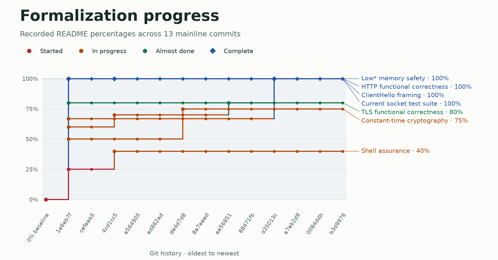

# secure-web-server

**Goal.** Serve an in-memory site snapshot over HTTP/1.1 and TLS 1.3 with machine-checked memory safety, routing correctness, and protocol behavior. Confine the serving process if a bug survives verification.

## Verification progress

All 21 F\* modules pass verification. We check Low\* contracts with F\* and Z3, extract the HTTP and TLS core to C with KaRaMeL, and link it into a Rust executable. Rust owns sockets and buffers. The FFI wrapper checks lengths and controls which buffers reach the verified core. [Protocol subset](docs/POLICY.md) · [Proofs](docs/PROOFS.md) · [Trust assumptions](docs/TRUST.md) · [Specification audit](docs/SPECIFICATION-AUDIT.md)

🔴 Started · 🟠 In progress · 🟢 Almost done · 🏁 Complete

Percentages count completed modules, test cases, or equally weighted roadmap milestones within each row. Fractions show the denominator.

| Area | Progress | Completed | Help finish |
|---|---|---|---|
| Low\* memory safety | 🏁 **100%** (21/21 modules) | All core modules verified for bounds, lifetimes, and arithmetic safety under their contracts. | |
| HTTP functional correctness | 🏁 **100%** (8/8 milestones) | Path normalization, lookup and routing, parser bounds and grammar, first-head consumption, and exact response headers and GET/HEAD body selection at the public handler. [HTTP proofs](docs/PROOFS.md#http-core-srchttpfst) | Prove acceptance completeness against an independent request grammar and refine the shell's pipelining behavior. |
| TLS functional correctness | 🟢 **93%** (25/27 milestones) | The public input contract covers client-order suite selection and session ID echo in the exact server flight, the authenticated client Finished transition, and exact application plaintext delivery. Record sealing, CertificateVerify DER, and key installation have functional contracts under the cryptographic bindings. [TLS proofs](docs/PROOFS.md#tls-13-srctlsfst) | Prove progress for supported peers and connect the state machine to the end-to-end protocol security model. |
| ClientHello framing | 🏁 **100%** (8/8 milestones) | EverParse verifies the local framing grammar. Aristotle checked the linked adapter's safety and exact prefix recognition. The F\* parser now accepts exactly the complete bodies in the concrete grammar under that binding. [ClientHello evidence](docs/evidence/aristotle-clienthello-validator.md) | |
| Constant-time cryptography | 🟢 **88%** (14/16 milestones) | We use upstream constant-time primitives and scan every Finished MAC byte. GCC and Clang timing checks cover Finished rejection, authenticated record opening, X25519, P-256 signing, and CertificateVerify in a ChaCha20-Poly1305 server flight. Memcheck traces record protection for both suites and CertificateVerify through DER serialization. The record-opening trace shows that the inner content-type scan iterates over the padding. [Timing results](docs/ASSURANCE.md#constant-time-checks) | Extend coverage across CPUs and build settings. Study microarchitectural effects. |
| Current socket test suite | 🏁 **100%** (23/23 tests) | Routing, path confinement, malformed requests, pipelined HEAD and GET, TLS request fragmentation and pipelining, and both TLS suites pass. The matrix varies C optimization and runs a build with ASan/UBSan instrumentation in the C core. | |
| Shell assurance | 🟠 **40%** (2/5 milestones) | Tested, sandboxed baseline and migration of socket, file, and buffer ownership to Rust. FFI and Linux syscall wrappers are trusted. | Specify and verify the socket loop, site loader, and sandbox policy. |

In-process fuzzing checks output bounds across 400,000 HTTP and 100,000 TLS inputs. ASan detects memory errors on exercised paths. UBSan checks selected undefined behavior, including signed overflow.

**Good places to start.** Specify the end-to-end TLS security model, or repeat the timing checks on another CPU. [TLS proofs](docs/PROOFS.md#tls-13-srctlsfst) · [Timing checks](docs/ASSURANCE.md#constant-time-checks)

### Formalization progress by commit



The TLS roadmap counts server-flight composition and client Finished integration separately, with one milestone each for the end-to-end security model and theorem. The eight earlier milestones account for 16 of the original 20 units. Aristotle’s CertificateVerify result adds two completed milestones for canonical DER encoding and for binding the actual signer output to the framed message. The public F\* API adds three completed TLS milestones for the server flight, Finished transition, and application records, plus two for suite selection and session ID echo. ClientHello framing counts the concrete F\* parser's completeness separately from the C validator proof. HTTP adds two for first-head framing and public response correctness. The constant-time roadmap splits its final milestone into X25519 timing and record-sealing traces, record-opening and CertificateVerify checks, coverage across CPUs and build settings, and microarchitectural analysis. The three earlier milestones account for 12 of the 16 units. [Proof inventory](docs/PROOFS.md) · [Assurance results](docs/ASSURANCE.md#constant-time-checks)

#### Milestone credits by commit

| Commit | Area | Progress | Completed |
|---|---|---|---|
| `d4a3083` | Constant-time cryptography | 🟢 **81%** (13/16 milestones) | Measured X25519 timing and traced record sealing. |
| `7871ffa` | Constant-time cryptography | 🟢 **88%** (14/16 milestones) | Traced record opening and CertificateVerify and measured CertificateVerify timing. |
| `d10505a` | TLS functional correctness | 🟢 **85%** (17/20 milestones) | Proved that the encrypted server flight, stored transcript, and application keys agree. |

The chart starts at the first mainline commit with a progress table and credits the work above at the commits that delivered it. The separate red 0% baseline is a visual reference. Blue diamonds mark completed areas. Hollow markers show working-tree values when included. Regenerate the published view with `python3 tools/plot_progress.py --committed-only` using Matplotlib.

## Defense in depth

| Defense | Intended effect |
|---|---|
| Restricted HTTP grammar | Accept GET and HEAD with no request bodies. Reject ambiguous body framing to reduce request-smuggling risk. |
| Snapshot routing | Load site files before serving, skip symlink entries, and resolve requests within the snapshot. This removes request-time filesystem traversal. |
| TLS 1.3 | Use ephemeral X25519 for forward secrecy, ECDSA P-256 certificates for server authentication, and AES-128-GCM or ChaCha20-Poly1305 for confidentiality and tamper detection. |
| Input and connection limits, idle timeout | Cap the request head at 8 KiB and 100 header lines, cap concurrent connections at 4,096, and reclaim idle connections after 15 seconds. These bound resource use for oversized requests and idle clients. |
| UID/GID drop, `no_new_privs` | Reduce permissions after startup and block privilege gains through exec. |
| Non-dumpable process, core limit | Reduce local exposure of keys through process inspection or crash dumps. |
| Landlock | Where available, deny covered filesystem operations. Network-capable Landlock also denies new TCP binds and connects. |
| seccomp-BPF | Kill the process on unlisted syscalls, including file opens, new sockets, and exec. |
| PIE + kernel ASLR | Randomize image placement to make reusable code and data addresses harder to predict. |
| RELRO + eager binding | Make relocated linkage tables read-only after startup to impede redirection through overwritten entries. |
| Non-executable stack, CET on C code where enforced | Block execution from the stack and restrict some forms of control-flow hijacking. |
| C stack canaries, stack-clash protection | Detect some stack overwrites and prevent large stack growth from jumping guard pages. |
| C FORTIFY and automatic zero initialization | Check selected library-call bounds and reduce disclosure of uninitialized stack data. |
| Static PIE | Eliminate dynamic-loader and shared-library lookup at startup. |
| Optional systemd unit | Limit filesystem writes, capabilities, and socket families. Deny writable-executable mappings and cap memory and task exhaustion. |

## Build and check

Requires Rust/Cargo and GCC on x86-64 Linux.

```sh
scripts/setup-toolchain.sh
make verify server
test/run.sh
make test-matrix fuzz
```

Deployment uses `make server-static`, the [certificate preparation tool](tools/prepare-cert.py), and the [example systemd unit](deploy/secure-web-server.service).
